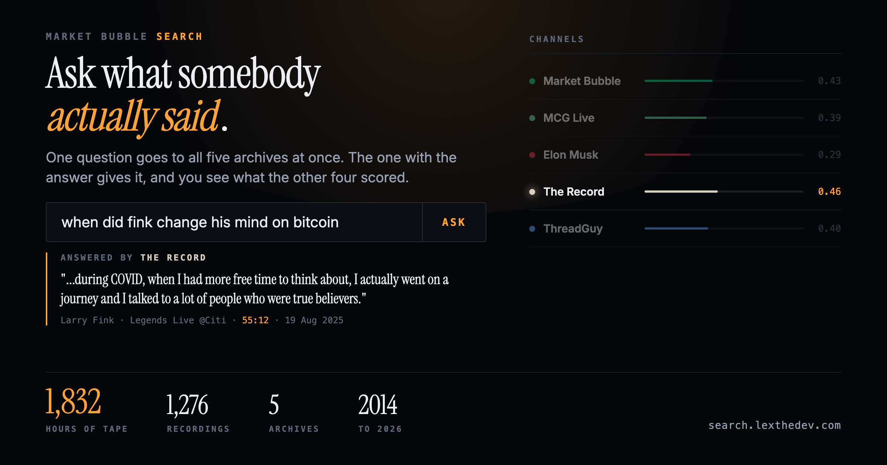

# Market Bubble Search



Ask crypto shows a question in plain English and land on the exact second
it was said.

**Live: https://search.lexthedev.com/home** · free, no login

Over 2,000 hours across five archives, transcribed and searchable by
meaning:

| Archive | What is in it |
|---|---|
| [Market Bubble](https://search.lexthedev.com/) | Every live X broadcast with Ansem and FaZe Banks. About a quarter of each show never reaches the YouTube upload, so for those minutes this is the only searchable copy. |
| [MCG Live](https://search.lexthedev.com/mcg) | Every episode, one project per episode, with the founder on the call. |
| [ThreadGuy](https://search.lexthedev.com/threadguy) | The daily market open streams and the interviews. |
| [Elon Musk](https://search.lexthedev.com/elon) | His long-form interviews, 2018 to 2026: Rogan, Lex Fridman, Dwarkesh Patel, All-In, the Economist. |
| [The Record](https://search.lexthedev.com/finance) | Our own collection, not a show: interviews and press conferences from the people who run the money, 2014 to 2026. Fink, Dalio, Powell, Warsh, Dimon, Cathie Wood, Schwarzman, Saylor, Raoul Pal, CZ. |

The front door sends one question to all five and the archive that knows
answers, with the sentence and a link that plays the recording at that
second. The archives never mix: a claim about the broadcast can never be
sourced from a Tesla interview.

## What else is on the site

- **Calls board** ([/calls](https://search.lexthedev.com/calls)). Every time
  Ansem or FaZe Banks said on air that they own something, named a pick or
  put a number on it, plus the same from Ansem's posts. Quoted word for
  word, linked to the second, priced from that day to today. Misses
  included; hedges and short-term trades are left off on purpose.
- **Token dashboards** for
  [Market Bubble](https://search.lexthedev.com/demo/assets.html),
  [MCG Live](https://search.lexthedev.com/mcg/assets) and
  [ThreadGuy](https://search.lexthedev.com/threadguy/tokens). Every token,
  stock and index each show discussed, ranked by how deeply it was covered.
- **Clips.** On Market Bubble, MCG Live and ThreadGuy, any moment can be cut
  into a video of up to two minutes, 1080p, with the words burned in from
  the transcript.
- **The X bot.** Tag [@mbubbleSearch](https://x.com/mbubbleSearch) with a
  question and it answers in public, with the quote and a link to the
  moment.
- **An open API.** JSON, no key, answers streamed as they are written.
  [llms.txt](https://search.lexthedev.com/llms.txt) says what is indexed and
  how to ask.
- **Support bots** on the same engine, answering from a company's own docs
  with sources: [Bullpen Concierge](https://concierge.lexthedev.com) for the
  BullpenFi terminal, and one for ClawPump.

Not affiliated with any show or its hosts. Informational only, not
financial advice.

## How it works

It is a RAG pipeline: pull the relevant passages from the transcripts
first, then answer only from those. If the archive does not have it, the
answer says so instead of guessing.

**Getting a recording in**

1. Transcribe it with Whisper (hosted on Groq, or locally with MLX). This
   works on X broadcasts, which have no captions at all.
2. Split it into ~2,400 character passages that keep their start time.
3. Embed each passage with Voyage AI and store it in Pinecone, one
   namespace per archive.
4. Fingerprint the voices so an answer knows who said a line, and refuse
   to name a speaker rather than guess.
5. Check it landed: the last step asks the live index about the new
   recording, and it does not count as ingested until it can be found.

MCG Live and ThreadGuy are picked up every morning by a scheduled job;
Market Bubble shows are added after they air.

**Answering a question**

1. Embed the question (cached, so a repeated question costs nothing).
2. Search by meaning in Pinecone, plus an exact-word index for rare tokens
   like tickers and names that an embedding barely moves for.
3. Rerank the candidates with Voyage's reranker.
4. Answer only from the passages that came back, citing the second each
   one starts. Questions about now ("this week", "the latest episode") are
   searched in the newest recordings first.

**The calls board** is built the other way round from search: a model
proposes calls from each show, code refuses anything that is not word for
word in the transcript or not in the host's voice, and a person reads
every row that is left. Prices come from Yahoo's chart data, by each
listing's own symbol.

## Stack

- Python 3.12, FastAPI, async throughout
- Pinecone (vectors), Voyage AI (embeddings and reranking)
- Claude Haiku for answers, with every model call going through
  [UsePod](https://usepod.ai)
- Whisper via Groq for transcription, yt-dlp and ffmpeg for clips
- Plain HTML, CSS and JavaScript for the pages, no build step
- Docker on Render, GitHub Actions for CI

## Project layout

```
app/                  the backend
  main.py             routes, static pages, share cards
  podcast.py          timestamped search over one archive (shared by all five)
  recency.py          "this week" and "the latest" questions
  terms.py            exact-word lookup for rare tokens
  attribution.py      refuses to put one host's words in the other's mouth
  calls.py            the calls board (pure: quotes, voices, tallies)
  call_prices.py      prices for the calls board
  posts.py            search over Ansem's own posts
  assets.py           token extraction and ranking
  clipper.py          captioned video clips
  x_bot.py            the X bot
  agent.py            the support bots
  security.py         rate limits and admin auth
demo/                 every page on the site
scripts/              ingest, transcribe, extract, build and verify
evals/                live evals: retrieval, coverage, faithfulness
tests/                the test suite (runs offline, no API keys)
data/                 shelves, speaker maps and built boards
```

## Run it locally

```bash
python -m venv .venv && source .venv/bin/activate
pip install -r requirements-dev.txt
cp .env.example .env   # fill in your keys
uvicorn app.main:app --reload
```

You need keys for Anthropic (or an Anthropic-compatible endpoint),
Voyage AI and Pinecone. The X bot is off unless `X_BOT_ENABLED=true`.

## Tests

```bash
ruff check .
pytest -q
```

The suite runs offline with no API keys, and CI runs both on every push.
It covers the search and answer contracts, the attribution rules, every
row on the calls board against its transcript, the pages themselves
(numbers that must come from the live archive, links, share cards), and
the security limits.

`evals/` holds the live evals: answers are audited against the exact
passages they were written from, quotes must appear in a retrieved
passage, and cited timestamps must be near a returned moment.
